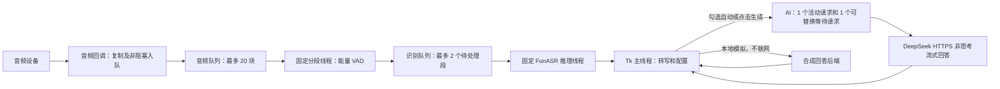

# 架构、延迟与本地模拟验证

验证日期：2026-10-11。环境：Windows、Conda Interview-Assistant、Python 3.10.20、NumPy 2.2.6。早期模拟验证与后续真实采集验证分别记录，实际采集结果见文末。

## 数据链路



停止监听、模型切换、取消及新问题替换均通过世代/请求编号阻止旧结果写回。Tk 变量只在主线程读取；后台通过事件队列传递结果。每轮 GUI 轮询处理最多 100 个事件，间隔 40 ms。

## 已发现和修复的问题

| 原有行为 | 影响 | 当前处理 |
|---|---|---|
| 音频队列持续入队，无人消费 | 长时间运行时内存持续增长 | 固定消费者、有界队列和过载提示 |
| 音频回调直接分段，逐采样转 Python float | 回调负担与对象开销 | 回调仅入队，分段保留 NumPy 块 |
| 每段创建新线程并竞争同一个推理锁 | 线程/等待音频无上限，锁不保证 FIFO | 单个 worker、有界 FIFO，过载丢弃最早待处理段 |
| 停止监听不作废正在推理的结果 | 旧识别可能在停止后显示或触发 AI | 推理世代与 GUI 监听世代双重校验 |
| 最长段仅统计语音帧，静音计数会重置 | 有间歇停顿的长段可能超出约定长度 | 累计所有实际缓冲帧 |
| `int(1.2 / 0.1)` 的浮点截断 | 默认可能在第 11 帧而非第 12 帧触发 | 有容差的向上取整 |
| CPU 选择与 GPU 状态文字混用 | 界面误报运行设备 | 按实际配置显示设备 |
| 没有 AI 模块与延迟指标 | 无法评估 AI 首字时间 | 流式客户端，首字/完成时间含 AI 排队时间 |

## 延迟应如何理解

从说话结束到 AI 首字，包含：静音判断 + 识别排队 + 本地推理 + GUI 调度 + AI 排队/网络/首字生成。AI 首字速度与完整回答速度不同，流式显示能让用户先看到内容，但不保证服务端推理更快。

默认使用句段式离线 ASR，另提供中文 Paraformer 流式模式。流式模式在说话中分块识别并显示临时文字，语句结束后才提交回答。两种模式使用不同模型；整句模式保留额外 VAD/标点模型，流式模式采用应用端能量阈值切句，当前没有标点恢复。

AI 使用官方 `deepseek-flash` / `deepseek-v4-pro`，默认 flash、`thinking.type=disabled`、流式、512 tokens。官方接口依据：[模型与入口](https://api-docs.deepseek.com/)、[Chat Completions](https://api-docs.deepseek.com/api/create-chat-completion/)。服务端、网络、账号限流和具体问题会影响真实延迟。

取消或替换会立即使旧输出失效。阻塞的网络读取只能在返回或 socket 超时后检查取消；默认单次网络等待上限 10 秒，总流检查时限 60 秒，不自动重试收费请求。最新问题可能等待旧请求结束，UI 的 AI 首字/完成指标包含这段排队时间；并非硬实时取消承诺。

## 本机模拟结果

所有音频为合成正弦波，ASR 替身设定等待 25 ms，AI 替身每 80 ms 输出一个块。音频加速注入，不代表真实采集。每种停顿配置 5 次，本表为中位数。

| 指标 | 默认 1.2 秒停顿 | 低延迟 0.6 秒停顿 |
|---|---:|---:|
| 识别队列等待 | 0.04 ms | 0.04 ms |
| 模拟 ASR 实际等待 | 33.49 ms | 32.87 ms |
| 模拟 AI 首字 | 89.91 ms | 87.59 ms |
| 模拟 AI 完整输出 | 358.96 ms | 357.99 ms |
| 加上逻辑静音等待后的首字估算 | 1326.00 ms | 722.78 ms |

首字估算不包含实际 GUI 调度与网络开销；它验证管线和可调停顿的影响，不能用作真实 DeepSeek、GPU 推理或识别准确率的承诺。Windows 线程调度使实际等待超过模拟设定值。

20 秒合成音频的缓冲原语对比：旧列表约 10,502,488 bytes、13.75 ms；NumPy 块约 1,304,056 bytes、0.73 ms。这只是缓冲容器的对象开销与构造耗时，不能外推为整个 ASR 加速倍数。旧音频队列仅数据载荷每小时约增长 230 MB；现在最多 20 块（0.1 秒、16 kHz、float32），队列载荷上限约 128 KB，模型和其他缓冲另算。

0.6 秒停顿缩短约 0.6 秒逻辑等待，但更容易在说话停顿处拆句。原基线为 1.2 秒；真实采集验证后 GUI 默认改为 0.6 秒，用户可根据实际噪声与语速调回。自动 AI 默认经过本地问题判定，确认语被过滤，明显未完成问题最多等待两秒后检查；对方仍在讲话或 ASR 未完成时继续等待。语义过滤是启发式规则，不保证完整理解。

## 复现

```powershell
# PowerShell 7.4+；启动后读取返回目录内 summary.json 和 exit-code.txt
.\scripts\run_checks.ps1

# 在已激活的 Conda 环境运行；报告目录被 Git 忽略
python scripts/simulate_latency.py --output .local/latency-report.json
```

本轮执行使用独立隐藏进程、日志和退出码文件。GUI 支持“本地模拟（不联网）”，无需 Key。模拟不打开音频设备，也不访问真实服务。

本机最终回归：28 项、0 失败、0 错误、0 跳过，真实退出码 0。覆盖合成音频到 GUI 自动触发和模拟 SSE 回答的完整链路。另已检查原生窗口捕获，验证 Key 遮罩、自动模式默认关闭、模拟回答与耗时显示。GitHub CI 配置已更新，但本轮没有推送或执行远端 CI。

上面的早期验证仅为模拟结果；后续真实音频采集与服务调用结果单独列在下面。


## 后续实际 VB-CABLE 验证（2026-10-11）

本地中文 TTS 通过 CABLE Input 实际播放、CABLE Output 实际采集，经真实 FunASR、GUI 自动触发及 DeepSeek 完整回答；非直接 PCM 注入。私有简历未发送。GTX 960 上，同一长问题的基线语音结束至完整回答约 7.93 秒；最终首次识别约 4.32 秒、热启动约 4.26 秒。热启动 ASR 推理约 1.29 秒，两个最终样本的内容忽略标点后正确，回答完整且音频消费队列无丢弃。样本少且设备/网络条件特定，不能作为普遍速度承诺。

保留 VAD 与标点，优化 FunASR 1.3.1 的运行配置复制：每次隔离可变字典/缓存，只共享已审查的只读前端与 CharTokenizer；未知对象仍深复制。其他版本或结构不支持时自动兼容，GUI 可关闭资源复用并重载。CPU 两线程在控制实验中仍慢于 CUDA；不能默认认定线程越多越快。GUI 停顿默认 0.6 秒，AI 默认简短可口述要点，仍保留 512 tokens 输出上限。

未验证物理麦克风、噪声和长会话；队列零丢弃不证明驱动层绝对无丢样。模型初始化仍约一分钟，与每轮回答延迟分别衡量。

## 中文流式模式对照（2026-10-11）

同一已知合成中文问题，经 VB-CABLE 实际播放与采集、GTX 960 上的真实 FunASR、GUI 自动回答及真实 DeepSeek。三轮独立测试，每轮分别运行整句模式和流式模式各两次；以下为最后一轮每种模式的第二次运行，停顿均为 0.6 秒。最终核心代码摘要与实测快照一致。

| 从实际语音结束开始计时 | 整句识别 | 流式识别 |
|---|---:|---:|
| 最终识别文本到达 | 1.674 秒 | 0.983 秒 |
| AI 首字到达 | 2.661 秒 | 1.729 秒 |
| AI 完整回答到达 | 4.404 秒 | 3.380 秒 |

最后一轮这一对照中，首字等待缩短约 35%，完整回答等待缩短约 23%。其流式两次完整回答均约 3.380 秒；第二轮分别约 2.977 与 3.317 秒；第一轮分别约 3.645 与 3.281 秒。网络与生成长度有波动，不能全部归因于 ASR。所有十二次识别忽略标点后的文本与合成原文一致；不等同于真实面试准确率测试。流式识别在语音结束前已有中间文字输出。

后两轮消费队列丢弃和 PortAudio 输入溢出计数均为零。私有简历未载入、未发送。当前保留整句模式默认，流式模式可手动启用；还需不同语速、噪声、术语、连续追问和物理麦克风的更大样本验证。流式输出暂不补标点，规则可能漏掉隐含问题；保留手动回答与关闭过滤选项。最终离线回归 56 项，零失败、零错误、零跳过。

复现使用 `scripts/run_streaming_benchmark.ps1 -Audio <指定合成问题的16k单声道PCM16文件> -InputDevice <CABLE输出输入设备编号> -OutputDevice <CABLE输入播放设备编号>`，默认 AI 为本地模拟。显式增加 `-RealAI` 才使用本机保存的 Key。脚本限定已知合成检索增强生成问题，转写不匹配时拒绝回答；符合时也只向模型发送固定合成问题，避免附加文字外传。日志、源码摘要、每次结果与退出码仅写入 Git 忽略的唯一 `.local/streaming-*` 目录。不更改系统默认音频设备。
