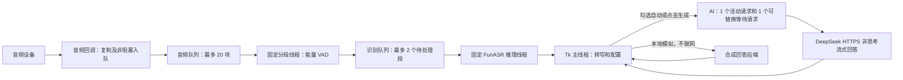

# 架构、延迟与本地模拟验证

验证日期：2026-10-11。环境：Windows、Conda Interview-Assistant、Python 3.10.20、NumPy 2.2.6。真实 FunASR / DeepSeek 的推理速度和识别准确率没有在本轮测量。

## 数据链路



停止监听、模型切换、取消及新问题替换均通过世代/请求编号阻止旧结果写回。Tk 变量只在主线程读取；后台通过事件队列传递结果。每轮 GUI 轮询处理最多 100 个事件，间隔 40 ms。

## 已发现和修复的问题

| 原有行为 | 影响 | 当前处理 |
|---|---|---|
| 音频队列持续入队，无人消费 | 长时间运行时内存持续增长 | 固定消费者、有界队列和过载提示 |
| 音频回调直接分段，逐采样转 Python float | 回调负担与对象开销 | 回调仅入队，分段保留 NumPy 块 |
| 每段创建新线程并竞争同一个推理锁 | 线程/等待音频无上限，锁不保证 FIFO | 单个 worker、有界 FIFO，过载丢弃最早待处理段 |
| 停止监听不作废正在推理的结果 | 旧识别可能在停止后显示或触发 AI | 推理世代与 GUI 监听世代双重校验 |
| 最长段仅统计语音帧，静音计数会重置 | 有间歇停顿的长段可能超出约定长度 | 累计所有实际缓冲帧 |
| `int(1.2 / 0.1)` 的浮点截断 | 默认可能在第 11 帧而非第 12 帧触发 | 有容差的向上取整 |
| CPU 选择与 GPU 状态文字混用 | 界面误报运行设备 | 按实际配置显示设备 |
| 没有 AI 模块与延迟指标 | 无法评估 AI 首字时间 | 流式客户端，首字/完成时间含 AI 排队时间 |

## 延迟应如何理解

从说话结束到 AI 首字，包含：静音判断 + 识别排队 + 本地推理 + GUI 调度 + AI 排队/网络/首字生成。AI 首字速度与完整回答速度不同，流式显示能让用户先看到内容，但不保证服务端推理更快。

当前仍为句段式离线 ASR，不在说话中持续输出修订文本。实时 streaming ASR、替换识别模型和识别准确率优化留待真实音频基准后评估。FunASR 内部的额外 VAD/标点模型可能增加工作量，但不能仅凭静态阅读就删除；需比较切分与标点质量。

AI 使用官方 `deepseek-flash` / `deepseek-v4-pro`，默认 flash、`thinking.type=disabled`、流式、512 tokens。官方接口依据：[模型与入口](https://api-docs.deepseek.com/)、[Chat Completions](https://api-docs.deepseek.com/api/create-chat-completion/)。服务端、网络、账号限流和具体问题会影响真实延迟。

取消或替换会立即使旧输出失效。阻塞的网络读取只能在返回或 socket 超时后检查取消；默认单次网络等待上限 10 秒，总流检查时限 60 秒，不自动重试收费请求。最新问题可能等待旧请求结束，UI 的 AI 首字/完成指标包含这段排队时间；并非硬实时取消承诺。

## 本机模拟结果

所有音频为合成正弦波，ASR 替身设定等待 25 ms，AI 替身每 80 ms 输出一个块。音频加速注入，不代表真实采集。每种停顿配置 5 次，本表为中位数。

| 指标 | 默认 1.2 秒停顿 | 低延迟 0.6 秒停顿 |
|---|---:|---:|
| 识别队列等待 | 0.04 ms | 0.04 ms |
| 模拟 ASR 实际等待 | 33.49 ms | 32.87 ms |
| 模拟 AI 首字 | 89.91 ms | 87.59 ms |
| 模拟 AI 完整输出 | 358.96 ms | 357.99 ms |
| 加上逻辑静音等待后的首字估算 | 1326.00 ms | 722.78 ms |

首字估算不包含实际 GUI 调度与网络开销；它验证管线和可调停顿的影响，不能用作真实 DeepSeek、GPU 推理或识别准确率的承诺。Windows 线程调度使实际等待超过模拟设定值。

20 秒合成音频的缓冲原语对比：旧列表约 10,502,488 bytes、13.75 ms；NumPy 块约 1,304,056 bytes、0.73 ms。这只是缓冲容器的对象开销与构造耗时，不能外推为整个 ASR 加速倍数。旧音频队列仅数据载荷每小时约增长 230 MB；现在最多 20 块（0.1 秒、16 kHz、float32），队列载荷上限约 128 KB，模型和其他缓冲另算。

0.6 秒停顿缩短约 0.6 秒逻辑等待，但更容易在说话停顿处拆句。默认保留 1.2 秒，用户可根据实际噪声与语速选择。自动 AI 逐段触发，过短切段还可能带来更多请求和取消。

## 复现

```powershell
# PowerShell 7.4+；启动后读取返回目录内 summary.json 和 exit-code.txt
.\scripts\run_checks.ps1

# 在已激活的 Conda 环境运行；报告目录被 Git 忽略
python scripts/simulate_latency.py --output .local/latency-report.json
```

本轮执行使用独立隐藏进程、日志和退出码文件。GUI 支持“本地模拟（不联网）”，无需 Key。模拟不打开音频设备，也不访问真实服务。

本机最终回归：28 项、0 失败、0 错误、0 跳过，真实退出码 0。覆盖合成音频到 GUI 自动触发和模拟 SSE 回答的完整链路。另已检查原生窗口捕获，验证 Key 遮罩、自动模式默认关闭、模拟回答与耗时显示。GitHub CI 配置已更新，但本轮没有推送或执行远端 CI。

下一步真实基准应采用有授权的脱敏音频，分别测量冷启动、热推理、中文准确率、CPU/GPU、默认和低延迟切分；真实 AI 需由用户配置 Key 并主动触发后记录首字和完成时间。本轮未执行这些外部调用。
